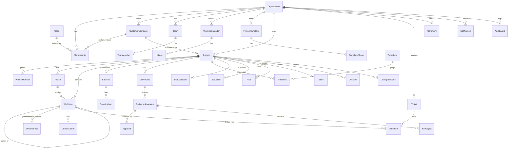

# Architecture

## 1. Product scope and key assumptions

O2 Support Hub is a multi-tenant customer-support and project-delivery application for an organization's managers and employees and for its external customers.

**Assumptions taken (routine decisions):**

| Topic | Decision |
|---|---|
| Tenancy | One database, row-level isolation by `organizationId`. Every query runs through an access helper that scopes by org and by the caller's project membership. |
| Identity | A `User` is global (unique email); `Membership` links a user to an organization with one org role. A session is bound to one organization. Multi-org users sign into their first active membership (an org switcher is a later addition). |
| Customers | A customer user belongs to exactly one `CustomerCompany`. They see a project only when **all** of these hold: an explicit `CUSTOMER` project membership, `project.customerVisible = true`, and the project belongs to their company. |
| Workflow statuses | Fixed status sets with documented transition rules (work items, tickets, projects). Org-configurable workflows are deferred; the transition tables live in `backend/src/domain/workflow.js`. |
| Scheduling | Manual scheduling with an impact preview. Nothing reschedules automatically. Only finish-to-start (FS) links are scheduled; SS/FF/SF can be stored and are clearly labelled "not scheduled". |
| Email | Not implemented. Notifications are persisted in-app; the UI states that email delivery is not configured. Invitation and reset links are shown once to the admin. |
| Charts | Chart.js (MIT), behind one `BarChart` component with a screen-reader data table. Timeline/Gantt is custom-built. No component requires a paid license. |
| Prisma | 7.10.1 with `@prisma/adapter-pg` (Rust-free runtime). The `latest` npm tag pointed at an 8.0 release candidate on 2026-11-17, so the stable 7.x line was used. |

## 2. System architecture

```
Browser (React 19 + Vite + Bootstrap 5 + Chart.js)
   │ same-origin /api (Vite proxy in dev, nginx in Docker/production)
   ▼
Express 5 API ──► routes → validation (zod) → authorization (policies/) → services/domain → Prisma
   │                                                                                     │
   ├─ storage/ (LocalStorage provider, backend/uploads)                                  ▼
   └─ jobs/ (in-process scheduler + Postgres advisory locks)                       PostgreSQL 16
```

Backend layout (`backend/src`):

| Folder | Responsibility |
|---|---|
| `config.js` | Validates environment at startup (zod); refuses insecure production cookies. |
| `auth/` | Password hashing (argon2id), sessions (DB-backed, hashed tokens), CSRF guard. |
| `policies/` | **Permission matrix** (`permissions.js`), record-level access loaders (`access.js`), allowlist serializers (`serializers.js`). |
| `domain/` | Pure, unit-tested calculations: working-day calendar, business hours, SLA, progress rollup, workflow rules, dependencies/critical path, capacity. |
| `services/` | Audit log, notifications, calendar loading, org bootstrap, polymorphic target resolution for comments/files. |
| `routes/` | REST endpoints (see `docs/API.md`). |
| `storage/` | Storage provider interface + local disk implementation. |
| `jobs/` | SLA evaluation, due-date reminders, cleanup (sessions, tokens, orphan files). |

**Background jobs.** Run inside the API process on intervals. Each run takes `pg_try_advisory_xact_lock`, so with several API instances exactly one runs a given job at a time. No Redis or queue is required at this scale; move to a queue when you need retries with backoff or outbound email.

## 3. Permission matrix

Org role capabilities (`ORG_CAPS`):

| Capability | Admin | Manager | Employee | Customer |
|---|:-:|:-:|:-:|:-:|
| Manage org settings, users, invitations, teams, customers, calendars, templates, SLA | ✔ | | | |
| View audit log | ✔ | | | |
| View people directory | ✔ | ✔ | ✔ | |
| Create projects | ✔ | ✔ | | |
| View all org tickets (service desk) | ✔ | ✔ | | |
| Work tickets (assign, internal notes, status) | ✔ | ✔ | ✔ | |
| Create tickets | ✔ | ✔ | ✔ | ✔ (own company only) |
| Workload view, portfolio reports | ✔ | ✔ (their projects) | | |
| Log time | ✔ | ✔ | ✔ | |

Effective **project role**: org Admin → `ADMIN` on every project in the org; everyone else → their `ProjectMember.role` or **no access**. An org Manager who is not a member of a project cannot see it.

Every project has a **Project Director** (`Project.directorId`, project role `DIRECTOR`) and a **Project Manager** (`Project.managerId`, role `MANAGER`); the rest of the team are **resources** (`MEMBER`). The director must be a different person from the manager, and only an administrator can change a director once set.

| Project capability | ADMIN | DIRECTOR | MANAGER | MEMBER | VIEWER | CUSTOMER |
|---|:-:|:-:|:-:|:-:|:-:|:-:|
| View project (customer: shared content only) | ✔ | ✔ | ✔ | ✔ | ✔ | ✔ |
| View internal content (all items, registers, baselines, activity) | ✔ | ✔ | ✔ | ✔ | ✔ | |
| Edit project, phases, members (resources), lifecycle | ✔ | | ✔ | | | |
| See budget, rate, billing | ✔ | ✔ | ✔ | | | |
| Create work items | ✔ | | ✔ | ✔ (self-assigned) | | |
| Edit any work item / bulk edit / delete | ✔ | | ✔ | | | |
| Edit own work (status, %, actuals, description, checklist) | ✔ | | ✔ | ✔ (assignee/collaborator) | | |
| Build the plan: tasks, sub-tasks, links, schedule, baselines | ✔ | | ✔ | | | |
| Send the plan for approval / take it back | ✔ | | ✔ | | | |
| **Approve the plan** (locks the original plan) or send it back | ✔ | ✔ | | | | |
| Internal comments | ✔ | ✔ | ✔ | ✔ | ✔ | |
| Customer-visible comments | ✔ | ✔ | ✔ | ✔ | | ✔ (forced public) |
| Upload files | ✔ | ✔ | ✔ | ✔ | | ✔ (forced public, shared items only) |
| Log time | ✔ | ✔ | ✔ | ✔ | | |
| **Approve timesheets** | Admin, or manager of **every** project on the sheet; never your own ||||||
| Manage documents (deliverables) / publish status updates | ✔ | | ✔ | | | |
| **Approve documents** | ✔ | ✔ first | | | | ✔ shared documents, after the director |
| Risks / issues / decisions / raise change requests | ✔ manage | view | ✔ manage | view | view | |
| **Approve or reject change requests** | ✔ | ✔ | | | | |
| CSV export | ✔ | ✔ | ✔ | ✔ | ✔ | tickets only |

Approval rules: nobody approves their own submission (the plan they sent, the document version they uploaded, the change request they raised, their own timesheet). A document shared with the client goes to the director first; the client sees it only after the director approved it. Waiting approvals are listed on each person's dashboard (`/api/dashboard` → `approvals`).

The matrix is served to the frontend in `/api/auth/me` so the UI hides controls consistently, but **every rule is enforced server-side**. Records outside the caller's scope return **404** (not 403) so identifiers cannot be probed.

**Customer data boundary.** Customers never receive internal comments or notes, internal files, estimates, assignees, budgets/rates, registers, baselines, timesheets, internal activity events, or other customers' data. This holds for APIs, notifications (mentions of a customer in internal comments are dropped), search, CSV exports, dashboards and activity feeds. The integration suite asserts each of these.

## 4. Data model



Key relationships:

- **Unified work hierarchy.** `WorkItem.type ∈ {MODULE, TASK, SUBTASK, MILESTONE}` with `parentId`. Allowed parents: MODULE→root; TASK→root or MODULE; SUBTASK→TASK; MILESTONE→root or MODULE. Children inherit the parent's phase. Keys are `PROJECTCODE-number` (per-project sequence).
- **Polymorphic attachments.** `Comment` and `FileObject` reference exactly one parent (work item, ticket, discussion, project, deliverable version). Access to them always resolves the parent first (`services/targets.js`).
- **Visibility.** `Visibility = INTERNAL | PUBLIC` on comments, files, discussions and audit events; `customerVisible` on projects, phases, work items, deliverables and status updates.
- **Concurrency.** `version` integer on projects, phases, work items, tickets, timesheets and deliverables. Updates use `WHERE id = ? AND version = ?`, and a mismatch returns 409 with the current record.
- **Constraints.** Unique: project code per org; work item number per project; ticket number per org; timesheet per user+week; approval per version+reviewer; dependency pair. Indexes on every foreign key used in filters.

## 5. Time and timezones

- All timestamps are `timestamptz` (UTC). Business dates (planned/actual dates, holidays, time-entry dates, week starts) are `date` columns and are never timezone-shifted.
- Each project has a `timezone` for display. Working-day arithmetic is pure date arithmetic on the project calendar.
- SLA clocks run in business minutes on the SLA policy's calendar (or the org default), interpreted in **that calendar's timezone** (`luxon`).
- Timesheet weeks are ISO weeks (Monday start) by calendar date.

## 6. File storage

`storage/index.js` exports a provider with `put`, `open`, `stat`, `remove` and `list`. `LocalStorage` writes to `backend/uploads/<2-hex>/<32-hex>` with random identifiers and stores the original name only as metadata. Keys are validated against a strict pattern, and paths are resolved and checked against the root to block traversal. Uploads are allowlisted by extension, the extension must match the content's magic bytes, and the content type is derived server-side. Downloads always go through `/api/files/:id/download`, which re-checks the parent's permissions and visibility and serves with `Content-Disposition: attachment` (inline only for images and PDF), `nosniff` and `CSP: sandbox`. Deletes are soft. The cleanup job removes bytes after 7 days, deletes orphaned objects older than 1 hour, and logs rows whose bytes are missing.

**Production implications of local storage:** the disk is a single point of failure and must be backed up together with the database (see `docs/OPERATIONS.md`). Several API instances need a **shared** volume (NFS/EFS) or an object-storage provider. Local disks are not shared automatically, and the app does not assume they are.

## 7. Implementation phases and status

| Phase | Status |
|---|---|
| 1. Foundation & project workflow | **Done:** auth, invitations, orgs/users/teams/customers, templates, guided project creation, phases, unified work hierarchy, assignments, comments with mentions, private attachments, dashboards |
| 2. Planning & execution | **Done:** list, Kanban, timeline, calendar, milestones, FS dependencies with cycle rejection, impact preview with explicit apply, progress rollups, time entries, weekly timesheets with approval/locking, workload. **Partial:** SS/FF/SF stored but not scheduled; no drag-to-resize on the timeline (click → dialog instead) |
| 3. Ticketing & customer collaboration | **Done:** customer portal, tickets, public replies vs internal notes, business-hours SLA with pause rules, reopen, ticket↔task links, create task from ticket, deliverable versions and approvals, discussions, status updates, in-app notifications. **Deferred:** email-to-ticket, outbound email |
| 4. Advanced management & hardening | **Done:** baselines and comparisons, critical path, risk/issue/decision/change-request registers (approval never alters the baseline), budget consumption, CSV exports with formula-injection protection, audit log, Docker/CI. **Partial/deferred:** configurable workflows, org switcher, resource leveling, scheduled report emails, MFA/SSO |
