# O2 Support Hub - Database structure

PostgreSQL schema `public` · 45 tables · 17 enum types · 62 foreign keys · 56 indexes · 7 migrations · generated 2026-11-23

All primary keys are UUIDs. Timestamps are `timestamptz` (UTC); plain dates are `date`. Every business table is scoped to an organisation, directly or through its project. The original (approved) plan is protected by the trigger `o2_protect_original_baseline` on `Baseline` and `BaselineItem`. Columns ending in `Id` without an arrow (for example `assigneeId`, `createdById`) point to a row in another table — usually `User` — and are checked by the application rather than by a database foreign key. The authoritative model definition is `prisma/schema.prisma`; the SQL history is in `prisma/migrations/`.

## Contents

- **Organisation, users and security**: [Organization](#organization), [User](#user), [Membership](#membership), [Session](#session), [PasswordResetToken](#passwordresettoken), [Invitation](#invitation), [Team](#team), [TeamMember](#teammember), [CustomerCompany](#customercompany), [AuditEvent](#auditevent), [Notification](#notification)
- **Projects and planning**: [Project](#project), [ProjectMember](#projectmember), [ProjectTemplate](#projecttemplate), [TemplatePhase](#templatephase), [Phase](#phase), [WorkItem](#workitem), [WorkItemCollaborator](#workitemcollaborator), [ChecklistItem](#checklistitem), [Dependency](#dependency), [Baseline](#baseline), [BaselineItem](#baselineitem), [WorkingCalendar](#workingcalendar), [Holiday](#holiday)
- **Time tracking**: [TimeEntry](#timeentry), [Timesheet](#timesheet)
- **Collaboration and governance**: [Comment](#comment), [Discussion](#discussion), [StatusUpdate](#statusupdate), [Deliverable](#deliverable), [DeliverableVersion](#deliverableversion), [Approval](#approval), [Risk](#risk), [Issue](#issue), [Decision](#decision), [ChangeRequest](#changerequest)
- **Support desk**: [Ticket](#ticket), [TicketCategory](#ticketcategory), [TicketLink](#ticketlink), [SlaPolicy](#slapolicy), [CannedResponse](#cannedresponse), [KnowledgeArticle](#knowledgearticle)
- **Files and system**: [FileObject](#fileobject), [FileBlob](#fileblob), [_prisma_migrations](#prismamigrations)
- [Relationship diagram](#relationship-diagram) · [Enum types](#enum-types) · [Triggers](#triggers) · [Migrations](#migrations)

## Relationship diagram

Main relationships (lookup links such as created-by/updated-by are omitted for readability). GitHub, VS Code and most Markdown viewers render this diagram.

```mermaid
erDiagram
  DeliverableVersion ||--o{ Approval : "deliverableVersionId"
  Organization ||--o{ AuditEvent : "organizationId"
  Project ||--o{ Baseline : "projectId"
  Baseline ||--o{ BaselineItem : "baselineId"
  Organization ||--o{ CannedResponse : "organizationId"
  Project ||--o{ ChangeRequest : "projectId"
  WorkItem ||--o{ ChecklistItem : "workItemId"
  Organization ||--o{ Comment : "organizationId"
  Organization ||--o{ CustomerCompany : "organizationId"
  Project ||--o{ Decision : "projectId"
  Phase ||--o{ Deliverable : "phaseId"
  Project ||--o{ Deliverable : "projectId"
  Deliverable ||--o{ DeliverableVersion : "deliverableId"
  WorkItem ||--o{ Dependency : "predecessorId"
  Project ||--o{ Dependency : "projectId"
  WorkItem ||--o{ Dependency : "successorId"
  Project ||--o{ Discussion : "projectId"
  DeliverableVersion ||--o{ FileObject : "deliverableVersionId"
  Organization ||--o{ FileObject : "organizationId"
  WorkingCalendar ||--o{ Holiday : "calendarId"
  Organization ||--o{ Invitation : "organizationId"
  Project ||--o{ Issue : "projectId"
  Organization ||--o{ KnowledgeArticle : "organizationId"
  CustomerCompany ||--o{ Membership : "customerCompanyId"
  Organization ||--o{ Membership : "organizationId"
  User ||--o{ Membership : "userId"
  Organization ||--o{ Notification : "organizationId"
  User ||--o{ Notification : "userId"
  User ||--o{ PasswordResetToken : "userId"
  Project ||--o{ Phase : "projectId"
  WorkingCalendar ||--o{ Project : "calendarId"
  CustomerCompany ||--o{ Project : "customerCompanyId"
  Organization ||--o{ Project : "organizationId"
  ProjectTemplate ||--o{ Project : "templateId"
  Project ||--o{ ProjectMember : "projectId"
  User ||--o{ ProjectMember : "userId"
  Organization ||--o{ ProjectTemplate : "organizationId"
  Project ||--o{ Risk : "projectId"
  Organization ||--o{ Session : "organizationId"
  User ||--o{ Session : "userId"
  Organization ||--o{ SlaPolicy : "organizationId"
  Project ||--o{ StatusUpdate : "projectId"
  Organization ||--o{ Team : "organizationId"
  Team ||--o{ TeamMember : "teamId"
  User ||--o{ TeamMember : "userId"
  ProjectTemplate ||--o{ TemplatePhase : "templateId"
  CustomerCompany ||--o{ Ticket : "customerCompanyId"
  Organization ||--o{ Ticket : "organizationId"
  Project ||--o{ Ticket : "projectId"
  Organization ||--o{ TicketCategory : "organizationId"
  Ticket ||--o{ TicketLink : "ticketId"
  WorkItem ||--o{ TicketLink : "workItemId"
  Organization ||--o{ TimeEntry : "organizationId"
  Project ||--o{ TimeEntry : "projectId"
  Timesheet ||--o{ TimeEntry : "timesheetId"
  WorkItem ||--o{ TimeEntry : "workItemId"
  Organization ||--o{ Timesheet : "organizationId"
  Phase ||--o{ WorkItem : "phaseId"
  Project ||--o{ WorkItem : "projectId"
  WorkItem ||--o{ WorkItemCollaborator : "workItemId"
  Organization ||--o{ WorkingCalendar : "organizationId"
```

## Enum types

| Type | Values |
|---|---|
| `ApprovalDecision` | APPROVED, CHANGES_REQUESTED |
| `ChangeRequestStatus` | SUBMITTED, UNDER_REVIEW, APPROVED, REJECTED, IMPLEMENTED |
| `DeliverableStatus` | DRAFT, IN_REVIEW, APPROVED, CHANGES_REQUESTED |
| `DependencyType` | FS, SS, FF, SF |
| `Health` | GREEN, AMBER, RED |
| `MembershipStatus` | ACTIVE, DISABLED |
| `OrgRole` | ADMIN, MANAGER, EMPLOYEE, CUSTOMER |
| `Priority` | LOW, MEDIUM, HIGH, CRITICAL |
| `ProjectRole` | MANAGER, MEMBER, VIEWER, CUSTOMER, DIRECTOR |
| `ProjectStatus` | DRAFT, ACTIVE, ON_HOLD, COMPLETED, CANCELLED, ARCHIVED |
| `RegisterStatus` | OPEN, IN_PROGRESS, CLOSED |
| `TicketStatus` | NEW, OPEN, IN_PROGRESS, WAITING_ON_CUSTOMER, RESOLVED, CLOSED |
| `TicketType` | BUG, SERVICE_REQUEST, QUESTION, CHANGE_REQUEST |
| `TimesheetStatus` | DRAFT, SUBMITTED, APPROVED, REJECTED |
| `Visibility` | INTERNAL, PUBLIC |
| `WorkItemType` | MODULE, TASK, SUBTASK, MILESTONE |
| `WorkStatus` | TODO, IN_PROGRESS, BLOCKED, IN_REVIEW, DONE, CANCELLED |

## Triggers

| Trigger | Table | Function | Purpose |
|---|---|---|---|
| `Baseline_protect_original` | `Baseline` | `o2_protect_original_baseline()` | Blocks UPDATE/DELETE of the original (first approved) baseline so the agreed plan can never be changed |
| `BaselineItem_protect_original` | `BaselineItem` | `o2_protect_original_baseline()` | Blocks UPDATE/DELETE of the original (first approved) baseline so the agreed plan can never be changed |

## Migrations

Applied automatically, in order, by `scripts/db-migrate.js` on every start (already-applied ones are skipped).

1. `20261117000000_init`
1. `20261118000000_support_desk`
1. `20261118100000_user_profile`
1. `20261118200000_original_plan`
1. `20261119000000_auto_schedule`
1. `20261120000000_project_director`
1. `20261123000000_designations_project_delete`

## Organisation, users and security

### Organization

Tenant. Every business record belongs to exactly one organisation (data isolation).

| Column | Type | Null | Default | Key / reference |
|---|---|---|---|---|
| `id` | uuid | no |  | **PK** |
| `name` | text | no |  |  |
| `slug` | text | no |  |  |
| `timezone` | text | no | `'UTC'::text` |  |
| `settings` | jsonb | no | `'{}'::jsonb` |  |
| `ticketSeq` | integer | no | `0` |  |
| `createdAt` | timestamptz | no | `CURRENT_TIMESTAMP` |  |
| `updatedAt` | timestamptz | no |  |  |

Indexes: unique (slug)

### User

A person who can sign in (staff or customer). Profile: title/designation, department, phone, employee id, weekly capacity.

| Column | Type | Null | Default | Key / reference |
|---|---|---|---|---|
| `id` | uuid | no |  | **PK** |
| `email` | text | no |  |  |
| `name` | text | no |  |  |
| `passwordHash` | text | no |  |  |
| `title` | text | yes |  |  |
| `skills` | text[] | no | `ARRAY[]::text[]` |  |
| `weeklyCapacityHours` | numeric(5,2) | no | `40` |  |
| `createdAt` | timestamptz | no | `CURRENT_TIMESTAMP` |  |
| `updatedAt` | timestamptz | no |  |  |
| `lastLoginAt` | timestamptz | yes |  |  |
| `department` | text | yes |  |  |
| `phone` | text | yes |  |  |
| `employeeId` | text | yes |  |  |
| `mustChangePassword` | boolean | no | `false` |  |

Indexes: unique (email)

### Membership

A user's role in an organisation (ADMIN, MANAGER, EMPLOYEE, CUSTOMER) and status; customers link to a CustomerCompany.

| Column | Type | Null | Default | Key / reference |
|---|---|---|---|---|
| `id` | uuid | no |  | **PK** |
| `organizationId` | uuid | no |  | → `Organization.id` (on delete cascade) |
| `userId` | uuid | no |  | → `User.id` (on delete cascade) |
| `role` | OrgRole | no |  |  |
| `status` | MembershipStatus | no | `'ACTIVE'::"MembershipStatus"` |  |
| `customerCompanyId` | uuid | yes |  | → `CustomerCompany.id` (on delete set null) |
| `createdAt` | timestamptz | no | `CURRENT_TIMESTAMP` |  |
| `projectDirector` | boolean | no | `false` |  |

Indexes: ("organizationId", role); unique ("organizationId", "userId")

### Session

Server-side login sessions (hashed token, expiry, idle timeout, CSRF secret).

| Column | Type | Null | Default | Key / reference |
|---|---|---|---|---|
| `id` | uuid | no |  | **PK** |
| `tokenHash` | text | no |  |  |
| `userId` | uuid | no |  | → `User.id` (on delete cascade) |
| `organizationId` | uuid | no |  | → `Organization.id` (on delete cascade) |
| `csrfToken` | text | no |  |  |
| `expiresAt` | timestamptz | no |  |  |
| `lastSeenAt` | timestamptz | no | `CURRENT_TIMESTAMP` |  |
| `createdAt` | timestamptz | no | `CURRENT_TIMESTAMP` |  |
| `ip` | text | yes |  |  |
| `userAgent` | text | yes |  |  |

Indexes: ("expiresAt"); unique ("tokenHash"); ("userId")

### PasswordResetToken

One-time password-reset tokens (hashed, expiring).

| Column | Type | Null | Default | Key / reference |
|---|---|---|---|---|
| `id` | uuid | no |  | **PK** |
| `userId` | uuid | no |  | → `User.id` (on delete cascade) |
| `tokenHash` | text | no |  |  |
| `expiresAt` | timestamptz | no |  |  |
| `usedAt` | timestamptz | yes |  |  |
| `createdAt` | timestamptz | no | `CURRENT_TIMESTAMP` |  |

Indexes: unique ("tokenHash")

### Invitation

Pending e-mail invitations with role, designation and department.

| Column | Type | Null | Default | Key / reference |
|---|---|---|---|---|
| `id` | uuid | no |  | **PK** |
| `organizationId` | uuid | no |  | → `Organization.id` (on delete cascade) |
| `email` | text | no |  |  |
| `name` | text | yes |  |  |
| `role` | OrgRole | no |  |  |
| `customerCompanyId` | uuid | yes |  |  |
| `tokenHash` | text | no |  |  |
| `invitedById` | uuid | no |  |  |
| `expiresAt` | timestamptz | no |  |  |
| `acceptedAt` | timestamptz | yes |  |  |
| `revokedAt` | timestamptz | yes |  |  |
| `createdAt` | timestamptz | no | `CURRENT_TIMESTAMP` |  |
| `title` | text | yes |  |  |
| `department` | text | yes |  |  |

Indexes: ("organizationId", email); unique ("tokenHash")

### Team

Internal teams inside an organisation.

| Column | Type | Null | Default | Key / reference |
|---|---|---|---|---|
| `id` | uuid | no |  | **PK** |
| `organizationId` | uuid | no |  | → `Organization.id` (on delete cascade) |
| `name` | text | no |  |  |
| `description` | text | yes |  |  |
| `createdAt` | timestamptz | no | `CURRENT_TIMESTAMP` |  |

Indexes: unique ("organizationId", name)

### TeamMember

Users in a team.

| Column | Type | Null | Default | Key / reference |
|---|---|---|---|---|
| `teamId` | uuid | no |  | **PK** → `Team.id` (on delete cascade) |
| `userId` | uuid | no |  | **PK** → `User.id` (on delete cascade) |

### CustomerCompany

External client companies; customers and projects link to these.

| Column | Type | Null | Default | Key / reference |
|---|---|---|---|---|
| `id` | uuid | no |  | **PK** |
| `organizationId` | uuid | no |  | → `Organization.id` (on delete cascade) |
| `name` | text | no |  |  |
| `domain` | text | yes |  |  |
| `notes` | text | yes |  |  |
| `createdAt` | timestamptz | no | `CURRENT_TIMESTAMP` |  |

Indexes: unique ("organizationId", name)

### AuditEvent

Append-only audit log of significant actions.

| Column | Type | Null | Default | Key / reference |
|---|---|---|---|---|
| `id` | uuid | no |  | **PK** |
| `organizationId` | uuid | no |  | → `Organization.id` (on delete cascade) |
| `actorId` | uuid | yes |  |  |
| `action` | text | no |  |  |
| `entityType` | text | no |  |  |
| `entityId` | text | yes |  |  |
| `projectId` | uuid | yes |  |  |
| `visibility` | Visibility | no | `'INTERNAL'::"Visibility"` |  |
| `metadata` | jsonb | no | `'{}'::jsonb` |  |
| `ip` | text | yes |  |  |
| `createdAt` | timestamptz | no | `CURRENT_TIMESTAMP` |  |

Indexes: ("entityType", "entityId"); ("organizationId", "createdAt"); ("projectId", "createdAt")

### Notification

In-app notifications per user.

| Column | Type | Null | Default | Key / reference |
|---|---|---|---|---|
| `id` | uuid | no |  | **PK** |
| `organizationId` | uuid | no |  | → `Organization.id` (on delete cascade) |
| `userId` | uuid | no |  | → `User.id` (on delete cascade) |
| `type` | text | no |  |  |
| `title` | text | no |  |  |
| `body` | text | yes |  |  |
| `link` | text | yes |  |  |
| `readAt` | timestamptz | yes |  |  |
| `emailStatus` | text | no | `'NOT_CONFIGURED'::text` |  |
| `dedupeKey` | text | yes |  |  |
| `createdAt` | timestamptz | no | `CURRENT_TIMESTAMP` |  |

Indexes: unique ("userId", "dedupeKey"); ("userId", "readAt", "createdAt")

## Projects and planning

### Project

A project: code, client, manager, dates, status, health, budget, hourly rate, client visibility, plan approval (planApprovedAt/By), optimistic-lock version.

| Column | Type | Null | Default | Key / reference |
|---|---|---|---|---|
| `id` | uuid | no |  | **PK** |
| `organizationId` | uuid | no |  | → `Organization.id` (on delete cascade) |
| `code` | text | no |  |  |
| `name` | text | no |  |  |
| `description` | text | yes |  |  |
| `objectives` | text | yes |  |  |
| `customerCompanyId` | uuid | yes |  | → `CustomerCompany.id` (on delete set null) |
| `managerId` | uuid | yes |  |  |
| `status` | ProjectStatus | no | `'DRAFT'::"ProjectStatus"` |  |
| `priority` | Priority | no | `'MEDIUM'::"Priority"` |  |
| `health` | Health | no | `'GREEN'::"Health"` |  |
| `plannedStart` | date | no |  |  |
| `plannedFinish` | date | no |  |  |
| `calendarId` | uuid | yes |  | → `WorkingCalendar.id` (on delete set null) |
| `timezone` | text | no | `'UTC'::text` |  |
| `budgetAmount` | numeric(14,2) | yes |  |  |
| `budgetCurrency` | text | yes |  |  |
| `billingEnabled` | boolean | no | `false` |  |
| `hourlyRate` | numeric(10,2) | yes |  |  |
| `customerVisible` | boolean | no | `false` |  |
| `templateId` | uuid | yes |  | → `ProjectTemplate.id` (on delete set null) |
| `workItemSeq` | integer | no | `0` |  |
| `version` | integer | no | `1` |  |
| `createdAt` | timestamptz | no | `CURRENT_TIMESTAMP` |  |
| `updatedAt` | timestamptz | no |  |  |
| `planApprovedAt` | timestamptz | yes |  |  |
| `planApprovedById` | uuid | yes |  |  |
| `directorId` | uuid | yes |  |  |
| `planSubmittedAt` | timestamptz | yes |  |  |
| `planSubmittedById` | uuid | yes |  |  |
| `planReturnedAt` | timestamptz | yes |  |  |
| `planReturnNote` | text | yes |  |  |

Indexes: unique ("organizationId", code); ("organizationId", status)

### ProjectMember

Project team: role (MANAGER/MEMBER/VIEWER/CUSTOMER) and allocation %.

| Column | Type | Null | Default | Key / reference |
|---|---|---|---|---|
| `projectId` | uuid | no |  | **PK** → `Project.id` (on delete cascade) |
| `userId` | uuid | no |  | **PK** → `User.id` (on delete cascade) |
| `role` | ProjectRole | no |  |  |
| `allocationPct` | integer | no | `100` |  |
| `createdAt` | timestamptz | no | `CURRENT_TIMESTAMP` |  |

Indexes: ("userId")

### ProjectTemplate

Reusable project plans.

| Column | Type | Null | Default | Key / reference |
|---|---|---|---|---|
| `id` | uuid | no |  | **PK** |
| `organizationId` | uuid | no |  | → `Organization.id` (on delete cascade) |
| `name` | text | no |  |  |
| `description` | text | yes |  |  |
| `isDefault` | boolean | no | `false` |  |
| `createdAt` | timestamptz | no | `CURRENT_TIMESTAMP` |  |

Indexes: unique ("organizationId", name)

### TemplatePhase

Phases (relative timing) of a template.

| Column | Type | Null | Default | Key / reference |
|---|---|---|---|---|
| `id` | uuid | no |  | **PK** |
| `templateId` | uuid | no |  | → `ProjectTemplate.id` (on delete cascade) |
| `name` | text | no |  |  |
| `sortOrder` | integer | no |  |  |
| `durationDays` | integer | no | `5` |  |
| `completionCriteria` | text | yes |  |  |
| `milestones` | text[] | no | `ARRAY[]::text[]` |  |
| `deliverables` | text[] | no | `ARRAY[]::text[]` |  |

Indexes: ("templateId", "sortOrder")

### Phase

Phases / stages of a project.

| Column | Type | Null | Default | Key / reference |
|---|---|---|---|---|
| `id` | uuid | no |  | **PK** |
| `projectId` | uuid | no |  | → `Project.id` (on delete cascade) |
| `name` | text | no |  |  |
| `sortOrder` | integer | no |  |  |
| `ownerId` | uuid | yes |  |  |
| `status` | WorkStatus | no | `'TODO'::"WorkStatus"` |  |
| `plannedStart` | date | yes |  |  |
| `plannedFinish` | date | yes |  |  |
| `completionCriteria` | text | yes |  |  |
| `customerVisible` | boolean | no | `true` |  |
| `version` | integer | no | `1` |  |

Indexes: ("projectId", "sortOrder")

### WorkItem

Modules, tasks, subtasks and milestones: hierarchy, assignee, status, priority, planned/actual dates, estimate, % complete.

| Column | Type | Null | Default | Key / reference |
|---|---|---|---|---|
| `id` | uuid | no |  | **PK** |
| `projectId` | uuid | no |  | → `Project.id` (on delete cascade) |
| `phaseId` | uuid | yes |  | → `Phase.id` (on delete set null) |
| `parentId` | uuid | yes |  | → `WorkItem.id` (on delete cascade) |
| `type` | WorkItemType | no |  |  |
| `number` | integer | no |  |  |
| `title` | text | no |  |  |
| `description` | text | yes |  |  |
| `acceptanceCriteria` | text | yes |  |  |
| `assigneeId` | uuid | yes |  |  |
| `status` | WorkStatus | no | `'TODO'::"WorkStatus"` |  |
| `priority` | Priority | no | `'MEDIUM'::"Priority"` |  |
| `plannedStart` | date | yes |  |  |
| `plannedFinish` | date | yes |  |  |
| `actualStart` | date | yes |  |  |
| `actualFinish` | date | yes |  |  |
| `estimateHours` | numeric(8,2) | yes |  |  |
| `percentComplete` | integer | no | `0` |  |
| `customerVisible` | boolean | no | `false` |  |
| `labels` | text[] | no | `ARRAY[]::text[]` |  |
| `sortOrder` | integer | no | `0` |  |
| `version` | integer | no | `1` |  |
| `createdById` | uuid | yes |  |  |
| `createdAt` | timestamptz | no | `CURRENT_TIMESTAMP` |  |
| `updatedAt` | timestamptz | no |  |  |
| `startConstraint` | date | yes |  |  |

Indexes: ("assigneeId"); unique ("projectId", number); ("projectId", "parentId"); ("projectId", "phaseId")

### WorkItemCollaborator

Extra people on a work item.

| Column | Type | Null | Default | Key / reference |
|---|---|---|---|---|
| `workItemId` | uuid | no |  | **PK** → `WorkItem.id` (on delete cascade) |
| `userId` | uuid | no |  | **PK** |

### ChecklistItem

Checklist lines inside a work item.

| Column | Type | Null | Default | Key / reference |
|---|---|---|---|---|
| `id` | uuid | no |  | **PK** |
| `workItemId` | uuid | no |  | → `WorkItem.id` (on delete cascade) |
| `text` | text | no |  |  |
| `done` | boolean | no | `false` |  |
| `sortOrder` | integer | no | `0` |  |

### Dependency

Links between work items (FS/SS/FF/SF with lag days).

| Column | Type | Null | Default | Key / reference |
|---|---|---|---|---|
| `id` | uuid | no |  | **PK** |
| `projectId` | uuid | no |  | → `Project.id` (on delete cascade) |
| `predecessorId` | uuid | no |  | → `WorkItem.id` (on delete cascade) |
| `successorId` | uuid | no |  | → `WorkItem.id` (on delete cascade) |
| `type` | DependencyType | no | `'FS'::"DependencyType"` |  |
| `lagDays` | integer | no | `0` |  |
| `createdAt` | timestamptz | no | `CURRENT_TIMESTAMP` |  |

Indexes: unique ("predecessorId", "successorId"); ("projectId")

### Baseline

Saved copies of the plan. kind = ORIGINAL (the approved plan: one per project, locked by a trigger), REVISION (re-plan after an approved change request) or SNAPSHOT.

| Column | Type | Null | Default | Key / reference |
|---|---|---|---|---|
| `id` | uuid | no |  | **PK** |
| `projectId` | uuid | no |  | → `Project.id` (on delete cascade) |
| `name` | text | no |  |  |
| `note` | text | yes |  |  |
| `createdById` | uuid | no |  |  |
| `createdAt` | timestamptz | no | `CURRENT_TIMESTAMP` |  |
| `kind` | text | no | `'SNAPSHOT'::text` |  |
| `changeRequestId` | uuid | yes |  |  |

Indexes: unique ("projectId") WHERE (kind = 'ORIGINAL'::text)

### BaselineItem

Each work item in a baseline: title, type, phase, owner, dates and estimate at the time it was saved.

| Column | Type | Null | Default | Key / reference |
|---|---|---|---|---|
| `id` | uuid | no |  | **PK** |
| `baselineId` | uuid | no |  | → `Baseline.id` (on delete cascade) |
| `workItemId` | uuid | no |  |  |
| `plannedStart` | date | yes |  |  |
| `plannedFinish` | date | yes |  |  |
| `estimateHours` | numeric(8,2) | yes |  |  |
| `title` | text | yes |  |  |
| `type` | text | yes |  |  |
| `assigneeId` | uuid | yes |  |  |
| `phaseId` | uuid | yes |  |  |
| `parentId` | uuid | yes |  |  |

Indexes: unique ("baselineId", "workItemId")

### WorkingCalendar

Working days/hours and time zone used for scheduling and SLA clocks.

| Column | Type | Null | Default | Key / reference |
|---|---|---|---|---|
| `id` | uuid | no |  | **PK** |
| `organizationId` | uuid | no |  | → `Organization.id` (on delete cascade) |
| `name` | text | no |  |  |
| `timezone` | text | no | `'UTC'::text` |  |
| `workDays` | integer[] | no | `ARRAY[1, 2, 3, 4, 5]` |  |
| `dayStart` | text | no | `'09:00'::text` |  |
| `dayEnd` | text | no | `'17:00'::text` |  |
| `isDefault` | boolean | no | `false` |  |
| `createdAt` | timestamptz | no | `CURRENT_TIMESTAMP` |  |

Indexes: unique ("organizationId", name)

### Holiday

Non-working dates of a calendar.

| Column | Type | Null | Default | Key / reference |
|---|---|---|---|---|
| `id` | uuid | no |  | **PK** |
| `calendarId` | uuid | no |  | → `WorkingCalendar.id` (on delete cascade) |
| `date` | date | no |  |  |
| `name` | text | no |  |  |

Indexes: unique ("calendarId", date)

## Time tracking

### TimeEntry

Hours logged by a user on a project / work item (billable flag).

| Column | Type | Null | Default | Key / reference |
|---|---|---|---|---|
| `id` | uuid | no |  | **PK** |
| `organizationId` | uuid | no |  | → `Organization.id` (on delete cascade) |
| `projectId` | uuid | no |  | → `Project.id` (on delete cascade) |
| `workItemId` | uuid | yes |  | → `WorkItem.id` (on delete set null) |
| `userId` | uuid | no |  |  |
| `timesheetId` | uuid | no |  | → `Timesheet.id` (on delete cascade) |
| `date` | date | no |  |  |
| `hours` | numeric(5,2) | no |  |  |
| `billable` | boolean | no | `false` |  |
| `note` | text | yes |  |  |
| `createdAt` | timestamptz | no | `CURRENT_TIMESTAMP` |  |
| `updatedAt` | timestamptz | no |  |  |

Indexes: ("projectId", date); ("userId", date); ("workItemId")

### Timesheet

Weekly timesheets and their approval status.

| Column | Type | Null | Default | Key / reference |
|---|---|---|---|---|
| `id` | uuid | no |  | **PK** |
| `organizationId` | uuid | no |  | → `Organization.id` (on delete cascade) |
| `userId` | uuid | no |  |  |
| `weekStart` | date | no |  |  |
| `status` | TimesheetStatus | no | `'DRAFT'::"TimesheetStatus"` |  |
| `submittedAt` | timestamptz | yes |  |  |
| `reviewedById` | uuid | yes |  |  |
| `reviewedAt` | timestamptz | yes |  |  |
| `reviewNote` | text | yes |  |  |
| `version` | integer | no | `1` |  |

Indexes: ("organizationId", status); unique ("userId", "weekStart")

## Collaboration and governance

### Comment

Comments on work items, deliverables and discussions (internal or client-visible).

| Column | Type | Null | Default | Key / reference |
|---|---|---|---|---|
| `id` | uuid | no |  | **PK** |
| `organizationId` | uuid | no |  | → `Organization.id` (on delete cascade) |
| `projectId` | uuid | yes |  |  |
| `workItemId` | uuid | yes |  |  |
| `ticketId` | uuid | yes |  |  |
| `discussionId` | uuid | yes |  |  |
| `authorId` | uuid | no |  |  |
| `body` | text | no |  |  |
| `visibility` | Visibility | no | `'INTERNAL'::"Visibility"` |  |
| `createdAt` | timestamptz | no | `CURRENT_TIMESTAMP` |  |
| `editedAt` | timestamptz | yes |  |  |
| `deletedAt` | timestamptz | yes |  |  |

Indexes: ("discussionId", "createdAt"); ("ticketId", "createdAt"); ("workItemId", "createdAt")

### Discussion

Project update threads.

| Column | Type | Null | Default | Key / reference |
|---|---|---|---|---|
| `id` | uuid | no |  | **PK** |
| `projectId` | uuid | no |  | → `Project.id` (on delete cascade) |
| `title` | text | no |  |  |
| `visibility` | Visibility | no | `'INTERNAL'::"Visibility"` |  |
| `createdById` | uuid | no |  |  |
| `createdAt` | timestamptz | no | `CURRENT_TIMESTAMP` |  |

### StatusUpdate

Periodic project status updates with health.

| Column | Type | Null | Default | Key / reference |
|---|---|---|---|---|
| `id` | uuid | no |  | **PK** |
| `projectId` | uuid | no |  | → `Project.id` (on delete cascade) |
| `authorId` | uuid | no |  |  |
| `title` | text | no |  |  |
| `body` | text | no |  |  |
| `health` | Health | no | `'GREEN'::"Health"` |  |
| `customerVisible` | boolean | no | `false` |  |
| `createdAt` | timestamptz | no | `CURRENT_TIMESTAMP` |  |

Indexes: ("projectId", "createdAt")

### Deliverable

Items the client approves.

| Column | Type | Null | Default | Key / reference |
|---|---|---|---|---|
| `id` | uuid | no |  | **PK** |
| `projectId` | uuid | no |  | → `Project.id` (on delete cascade) |
| `phaseId` | uuid | yes |  | → `Phase.id` (on delete set null) |
| `name` | text | no |  |  |
| `description` | text | yes |  |  |
| `customerVisible` | boolean | no | `false` |  |
| `status` | DeliverableStatus | no | `'DRAFT'::"DeliverableStatus"` |  |
| `dueDate` | date | yes |  |  |
| `version` | integer | no | `1` |  |
| `createdAt` | timestamptz | no | `CURRENT_TIMESTAMP` |  |

### DeliverableVersion

Uploaded versions of a deliverable.

| Column | Type | Null | Default | Key / reference |
|---|---|---|---|---|
| `id` | uuid | no |  | **PK** |
| `deliverableId` | uuid | no |  | → `Deliverable.id` (on delete cascade) |
| `versionNumber` | integer | no |  |  |
| `note` | text | yes |  |  |
| `createdById` | uuid | no |  |  |
| `createdAt` | timestamptz | no | `CURRENT_TIMESTAMP` |  |

Indexes: unique ("deliverableId", "versionNumber")

### Approval

Client approval decisions.

| Column | Type | Null | Default | Key / reference |
|---|---|---|---|---|
| `id` | uuid | no |  | **PK** |
| `deliverableVersionId` | uuid | no |  | → `DeliverableVersion.id` (on delete cascade) |
| `reviewerId` | uuid | no |  |  |
| `decision` | ApprovalDecision | no |  |  |
| `comment` | text | yes |  |  |
| `createdAt` | timestamptz | no | `CURRENT_TIMESTAMP` |  |

Indexes: unique ("deliverableVersionId", "reviewerId")

### Risk

Risk register (probability x impact 1-5, owner, mitigation).

| Column | Type | Null | Default | Key / reference |
|---|---|---|---|---|
| `id` | uuid | no |  | **PK** |
| `projectId` | uuid | no |  | → `Project.id` (on delete cascade) |
| `title` | text | no |  |  |
| `description` | text | yes |  |  |
| `probability` | integer | no | `3` |  |
| `impact` | integer | no | `3` |  |
| `ownerId` | uuid | yes |  |  |
| `mitigation` | text | yes |  |  |
| `status` | RegisterStatus | no | `'OPEN'::"RegisterStatus"` |  |
| `workItemId` | uuid | yes |  |  |
| `createdAt` | timestamptz | no | `CURRENT_TIMESTAMP` |  |

### Issue

Issue register (severity 1-5, target date).

| Column | Type | Null | Default | Key / reference |
|---|---|---|---|---|
| `id` | uuid | no |  | **PK** |
| `projectId` | uuid | no |  | → `Project.id` (on delete cascade) |
| `title` | text | no |  |  |
| `description` | text | yes |  |  |
| `severity` | integer | no | `3` |  |
| `ownerId` | uuid | yes |  |  |
| `targetDate` | date | yes |  |  |
| `status` | RegisterStatus | no | `'OPEN'::"RegisterStatus"` |  |
| `workItemId` | uuid | yes |  |  |
| `createdAt` | timestamptz | no | `CURRENT_TIMESTAMP` |  |

### Decision

Decision log.

| Column | Type | Null | Default | Key / reference |
|---|---|---|---|---|
| `id` | uuid | no |  | **PK** |
| `projectId` | uuid | no |  | → `Project.id` (on delete cascade) |
| `title` | text | no |  |  |
| `context` | text | yes |  |  |
| `decision` | text | no |  |  |
| `decidedById` | uuid | yes |  |  |
| `decidedOn` | date | no |  |  |
| `workItemId` | uuid | yes |  |  |
| `createdAt` | timestamptz | no | `CURRENT_TIMESTAMP` |  |

### ChangeRequest

Change requests with schedule/cost impact and review status.

| Column | Type | Null | Default | Key / reference |
|---|---|---|---|---|
| `id` | uuid | no |  | **PK** |
| `projectId` | uuid | no |  | → `Project.id` (on delete cascade) |
| `title` | text | no |  |  |
| `scope` | text | no |  |  |
| `scheduleImpactDays` | integer | no | `0` |  |
| `costImpact` | numeric(14,2) | yes |  |  |
| `reviewerId` | uuid | yes |  |  |
| `status` | ChangeRequestStatus | no | `'SUBMITTED'::"ChangeRequestStatus"` |  |
| `outcomeNote` | text | yes |  |  |
| `ticketId` | uuid | yes |  |  |
| `decidedAt` | timestamptz | yes |  |  |
| `createdById` | uuid | no |  |  |
| `createdAt` | timestamptz | no | `CURRENT_TIMESTAMP` |  |

## Support desk

### Ticket

Support tickets: requester, client, project, type, priority, status, assignee, SLA timestamps, tags, satisfaction rating.

| Column | Type | Null | Default | Key / reference |
|---|---|---|---|---|
| `id` | uuid | no |  | **PK** |
| `organizationId` | uuid | no |  | → `Organization.id` (on delete cascade) |
| `number` | integer | no |  |  |
| `subject` | text | no |  |  |
| `description` | text | no |  |  |
| `customerCompanyId` | uuid | yes |  | → `CustomerCompany.id` (on delete set null) |
| `projectId` | uuid | yes |  | → `Project.id` (on delete set null) |
| `category` | text | yes |  |  |
| `type` | TicketType | no | `'QUESTION'::"TicketType"` |  |
| `priority` | Priority | no | `'MEDIUM'::"Priority"` |  |
| `severity` | integer | no | `3` |  |
| `status` | TicketStatus | no | `'NEW'::"TicketStatus"` |  |
| `assigneeId` | uuid | yes |  |  |
| `requesterId` | uuid | no |  |  |
| `responseDueAt` | timestamptz | yes |  |  |
| `resolutionDueAt` | timestamptz | yes |  |  |
| `firstResponseAt` | timestamptz | yes |  |  |
| `resolvedAt` | timestamptz | yes |  |  |
| `closedAt` | timestamptz | yes |  |  |
| `slaPausedAt` | timestamptz | yes |  |  |
| `reopenCount` | integer | no | `0` |  |
| `version` | integer | no | `1` |  |
| `createdAt` | timestamptz | no | `CURRENT_TIMESTAMP` |  |
| `updatedAt` | timestamptz | no |  |  |
| `tags` | text[] | no | `ARRAY[]::text[]` |  |
| `csatRating` | integer | yes |  |  |
| `csatComment` | text | yes |  |  |
| `csatAt` | timestamptz | yes |  |  |

Indexes: ("assigneeId"); ("customerCompanyId"); unique ("organizationId", number); ("organizationId", status)

### TicketCategory

Ticket categories.

| Column | Type | Null | Default | Key / reference |
|---|---|---|---|---|
| `id` | uuid | no |  | **PK** |
| `organizationId` | uuid | no |  | → `Organization.id` (on delete cascade) |
| `name` | text | no |  |  |

Indexes: unique ("organizationId", name)

### TicketLink

Links between tickets and work items.

| Column | Type | Null | Default | Key / reference |
|---|---|---|---|---|
| `ticketId` | uuid | no |  | **PK** → `Ticket.id` (on delete cascade) |
| `workItemId` | uuid | no |  | **PK** → `WorkItem.id` (on delete cascade) |
| `linkType` | text | no | `'RELATES'::text` |  |
| `createdAt` | timestamptz | no | `CURRENT_TIMESTAMP` |  |

### SlaPolicy

First-response and resolution targets per priority (business hours).

| Column | Type | Null | Default | Key / reference |
|---|---|---|---|---|
| `id` | uuid | no |  | **PK** |
| `organizationId` | uuid | no |  | → `Organization.id` (on delete cascade) |
| `priority` | Priority | no |  |  |
| `responseMinutes` | integer | no |  |  |
| `resolutionMinutes` | integer | no |  |  |
| `calendarId` | uuid | yes |  |  |

Indexes: unique ("organizationId", priority)

### CannedResponse

Saved reply templates for agents.

| Column | Type | Null | Default | Key / reference |
|---|---|---|---|---|
| `id` | uuid | no |  | **PK** |
| `organizationId` | uuid | no |  | → `Organization.id` (on delete cascade) |
| `title` | text | no |  |  |
| `body` | text | no |  |  |
| `createdById` | uuid | no |  |  |
| `createdAt` | timestamptz | no | `CURRENT_TIMESTAMP` |  |
| `updatedAt` | timestamptz | no |  |  |

Indexes: ("organizationId")

### KnowledgeArticle

Help-centre / knowledge-base articles (public or internal).

| Column | Type | Null | Default | Key / reference |
|---|---|---|---|---|
| `id` | uuid | no |  | **PK** |
| `organizationId` | uuid | no |  | → `Organization.id` (on delete cascade) |
| `title` | text | no |  |  |
| `body` | text | no |  |  |
| `category` | text | no | `'General'::text` |  |
| `visibility` | Visibility | no | `'PUBLIC'::"Visibility"` |  |
| `published` | boolean | no | `false` |  |
| `authorId` | uuid | no |  |  |
| `views` | integer | no | `0` |  |
| `helpfulYes` | integer | no | `0` |  |
| `helpfulNo` | integer | no | `0` |  |
| `createdAt` | timestamptz | no | `CURRENT_TIMESTAMP` |  |
| `updatedAt` | timestamptz | no |  |  |

Indexes: ("organizationId", published)

## Files and system

### FileObject

Metadata of uploaded files (owner entity, size, type, storage key).

| Column | Type | Null | Default | Key / reference |
|---|---|---|---|---|
| `id` | uuid | no |  | **PK** |
| `organizationId` | uuid | no |  | → `Organization.id` (on delete cascade) |
| `projectId` | uuid | yes |  |  |
| `workItemId` | uuid | yes |  |  |
| `ticketId` | uuid | yes |  |  |
| `deliverableVersionId` | uuid | yes |  | → `DeliverableVersion.id` (on delete set null) |
| `storageKey` | text | no |  |  |
| `originalName` | text | no |  |  |
| `mimeType` | text | no |  |  |
| `size` | integer | no |  |  |
| `sha256` | text | no |  |  |
| `visibility` | Visibility | no | `'INTERNAL'::"Visibility"` |  |
| `uploadedById` | uuid | no |  |  |
| `createdAt` | timestamptz | no | `CURRENT_TIMESTAMP` |  |
| `deletedAt` | timestamptz | yes |  |  |

Indexes: ("projectId"); unique ("storageKey"); ("ticketId"); ("workItemId")

### FileBlob

File contents when STORAGE_DRIVER=db.

| Column | Type | Null | Default | Key / reference |
|---|---|---|---|---|
| `key` | text | no |  | **PK** |
| `data` | bytea | no |  |  |
| `size` | integer | no |  |  |
| `createdAt` | timestamptz | no | `CURRENT_TIMESTAMP` |  |

### _prisma_migrations

Migration history (which schema versions are applied).

| Column | Type | Null | Default | Key / reference |
|---|---|---|---|---|
| `id` | varchar(36) | no |  | **PK** |
| `checksum` | varchar(64) | no |  |  |
| `finished_at` | timestamptz | yes |  |  |
| `migration_name` | varchar(255) | no |  |  |
| `logs` | text | yes |  |  |
| `rolled_back_at` | timestamptz | yes |  |  |
| `started_at` | timestamptz | no | `now()` |  |
| `applied_steps_count` | integer | no | `0` |  |
